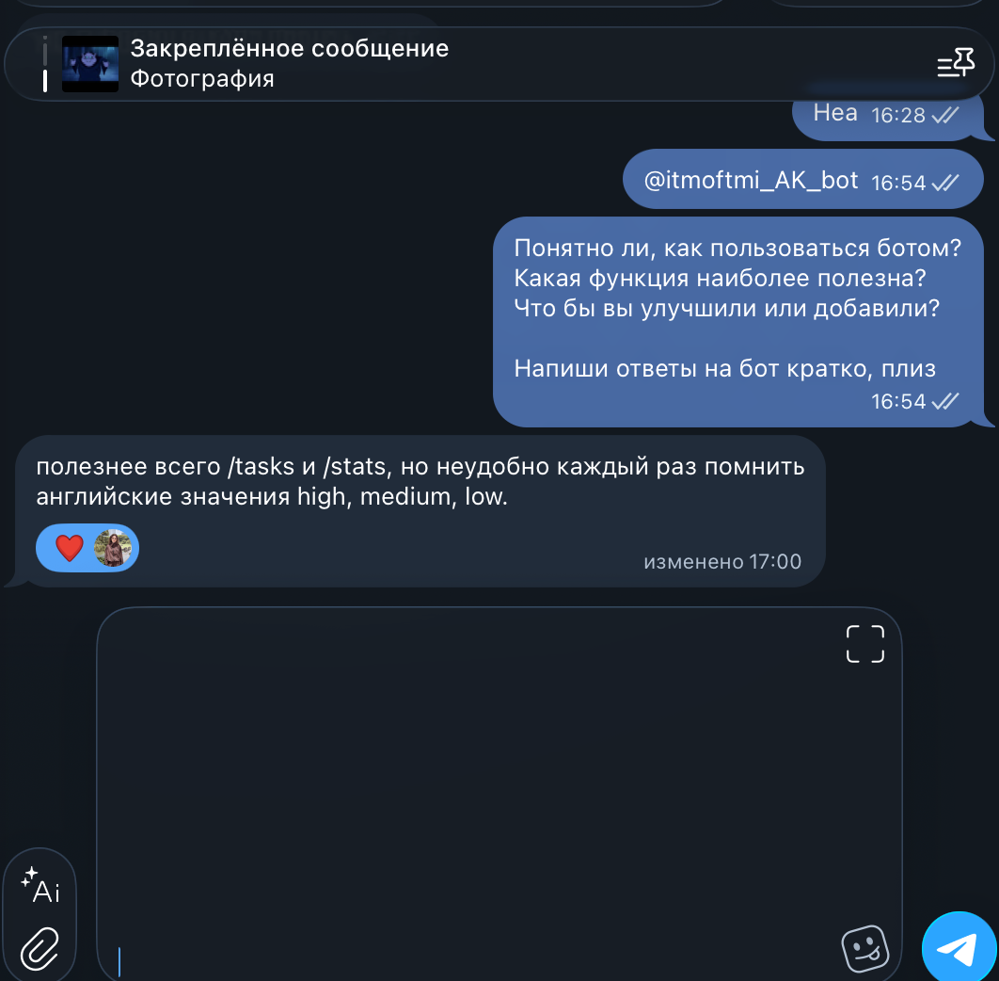
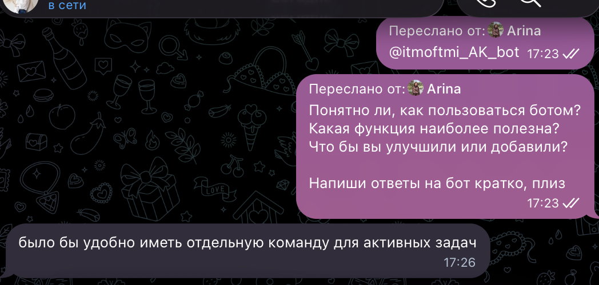
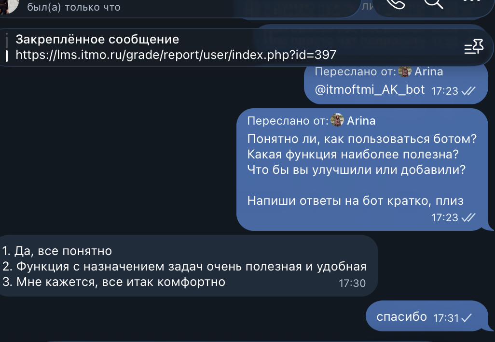

University: [ITMO University](https://itmo.ru/ru/)  
Faculty: [FICT](https://fict.itmo.ru)  
Course: Vibe Coding: AI-боты для бизнеса  
Year: 2026  
Author: Kuhi Arina  
Lab: Lab3  
Date of create: 13.10.2026  
Date of finished: 13.10.2026  

# Лабораторная работа №3

## 1. Цель работы

Развернуть Telegram-бота в облачной среде, обеспечить его работу независимо от локального компьютера, провести пользовательское тестирование и внести улучшение на основании полученной обратной связи.

## 2. Исходный проект

В качестве основы для лабораторной работы использовался Telegram-бот Task Assistant Bot, разработанный в предыдущих лабораторных работах.

Username бота:

`@itmoftmi_AK_bot`

Бот предназначен для управления персональными задачами.

До выполнения Lab3 в боте были реализованы следующие команды:

- `/start` — запуск бота;
- `/help` — список доступных команд;
- `/add <приоритет> <задача>` — добавление задачи;
- `/tasks` — просмотр списка задач;
- `/done <номер>` — отметка задачи выполненной;
- `/delete <номер>` — удаление задачи;
- `/stats` — статистика задач.

Для хранения данных используется база данных SQLite.

## 3. Задача лабораторной работы

Основной задачей Lab3 являлось развертывание Telegram-бота в облачной инфраструктуре.

До деплоя бот запускался локально командой:

`python bot.py`

При таком подходе бот работал только в тот момент, когда компьютер был включён, Terminal оставался открытым, а Python-процесс продолжал выполняться.

Целью деплоя было обеспечить работу бота независимо от локального компьютера.

## 4. Выбор платформы для деплоя

Для размещения приложения была выбрана платформа Railway.

Railway позволяет:

- подключить GitHub-репозиторий;
- автоматически собирать Python-проект;
- хранить переменные окружения;
- запускать приложение в облаке;
- автоматически выполнять повторный деплой после обновления кода;
- просматривать Build Logs и Deploy Logs.

Репозиторий проекта:

`2026-chatbots-kuhi_arina`

Для Lab3 используется отдельная директория:

`/lab3`

## 5. Подготовка проекта к деплою

Для третьей лабораторной работы была создана отдельная папка:

`lab3`

В ней находятся основные файлы:

- `bot.py`;
- `requirements.txt`;
- `.env.example`;
- `Procfile`;
- `README.md`;
- `lab3_report.md`.

Локальный файл `.env` не загружается в GitHub.

Также из Git исключены локальная база данных и файлы логов.

## 6. Настройка Railway

Для деплоя был подключен GitHub-репозиторий:

`2026-chatbots-kuhi_arina`

Так как репозиторий содержит несколько лабораторных работ, в Railway был указан Root Directory:

`/lab3`

Команда запуска приложения:

`python bot.py`

Telegram Bot Token был добавлен в Railway через Variables:

`BOT_TOKEN`

Значение токена не хранится непосредственно в коде и не публикуется в GitHub.

После настройки Railway выполнил сборку и запуск приложения.

## 7. Работа бота после деплоя

После успешного deployment бот стал работать без локального запуска через Terminal.

Для проверки локальный Python-процесс был остановлен.

После этого в Telegram была отправлена команда:

`/start`

Бот продолжил отвечать, что подтвердило успешный запуск приложения на Railway.

Таким образом, бот работает независимо от локального компьютера.

## 8. Логирование

В Lab3 в приложение было добавлено стандартное логирование Python.

Используется модуль:

`logging`

Логирование позволяет отслеживать запуск приложения и возможные ошибки через Deploy Logs в Railway.

При успешном запуске приложения в логах появляется сообщение о старте Telegram-бота.

## 9. Пользовательское тестирование

После деплоя было проведено пользовательское тестирование бота.

В тестировании приняли участие три пользователя.

Каждый пользователь проверил основные команды бота, в том числе:

- `/start`;
- `/help`;
- `/add`;
- `/tasks`;
- `/done`;
- `/delete`;
- `/stats`.

Также пользователи оценили удобство использования бота и предложили возможные улучшения.

### Пользователь 1

Пользователь отметил, что основной функционал понятен, однако при большом количестве задач неудобно просматривать одновременно выполненные и невыполненные задачи.

Предложение:

добавить возможность отдельно выводить только активные задачи.

### Пользователь 2

Пользователь отметил полезность команд `/tasks` и `/stats`.

При этом было отмечено, что после выполнения части задач общий список становится менее удобным для ежедневного использования.

Предложение:

реализовать отдельный список текущих незавершённых задач.

### Пользователь 3

Пользователь отметил, что бот прост в использовании и основные команды понятны.

В качестве улучшения было предложено добавить команду, которая показывает только актуальные задачи, не включая завершённые.

## 10. Анализ обратной связи

Наиболее часто встречающимся предложением стало разделение общего списка задач и списка активных задач.

В существующей версии команда:

`/tasks`

показывала одновременно активные и выполненные задачи.

При большом количестве записей это затрудняет быстрый просмотр текущих дел.

Поэтому было принято решение добавить новую команду:

`/active`

## 11. Реализованное улучшение

На основании результатов тестирования была реализована команда:

`/active`

Команда получает из SQLite только задачи со статусом:

`done = 0`

Для получения данных используется SQL-запрос с условием:

`WHERE user_id = ? AND done = 0`

Дополнительно активные задачи сортируются по приоритету:

1. высокий;
2. средний;
3. низкий.

Если активных задач нет, бот сообщает пользователю:

`У тебя нет активных задач.`

## 12. Обновленный функционал

После улучшения бот поддерживает следующие команды:

- `/start` — запустить бота;
- `/help` — показать доступные команды;
- `/add <приоритет> <задача>` — добавить задачу;
- `/tasks` — показать все задачи;
- `/active` — показать только активные задачи;
- `/done <номер>` — отметить задачу выполненной;
- `/delete <номер>` — удалить задачу;
- `/stats` — показать статистику.

## 13. Итеративная разработка с использованием LLM

Для доработки проекта использовался ChatGPT.

### Исходный запрос для Lab3

Подготовь Telegram-бота Task Assistant Bot к облачному деплою.

Бот написан на Python с использованием python-telegram-bot и SQLite.

Необходимо:

- сохранить текущий функционал;
- добавить логирование;
- подготовить приложение для запуска на Railway;
- хранить Telegram Bot Token через переменную окружения;
- использовать отдельную директорию lab3;
- запускать приложение командой python bot.py.

### Промпт после получения обратной связи

На основании пользовательского тестирования добавь в Telegram-бот новую команду `/active`.

Команда должна:

- показывать только незавершённые задачи текущего пользователя;
- получать данные из SQLite;
- использовать условие `done = 0`;
- сортировать задачи по приоритету: высокий, средний, низкий;
- выводить понятное сообщение, если активных задач нет;
- быть добавлена в `/help`.

## 14. Проблемы в процессе деплоя

В процессе развертывания возникло несколько технических проблем.

### Неправильная директория сборки

Первоначально Railway пытался собрать проект из корня GitHub-репозитория.

Так как файл `bot.py` для Lab3 находится в отдельной папке, сборка завершалась ошибкой.

Проблема была решена установкой:

`Root Directory = /lab3`

### Переменная BOT_TOKEN

Telegram Bot Token необходимо было отдельно добавить в Railway Variables.

Локальный `.env` не используется облачной платформой.

После добавления `BOT_TOKEN` приложение смогло подключиться к Telegram Bot API.

### Недействительный токен

В процессе тестирования одна из локальных версий использовала недействительный Telegram token.

Telegram API возвращал ошибку:

`telegram.error.InvalidToken`

После обновления токена приложение снова начало работать.

### Обновление версии на Railway

После добавления команды `/active` новая версия сначала существовала только локально.

Railway продолжал использовать предыдущую версию из GitHub.

После выполнения:

`git add`

`git commit`

`git push`

Railway получил новую версию и выполнил повторный deployment.

## 15. Проверка стабильности

После успешного деплоя была проведена проверка работы бота.

Локальный Terminal был закрыт, после чего в Telegram были протестированы команды:

`/start`

`/help`

`/tasks`

`/active`

`/stats`

Бот продолжил отвечать, что подтверждает его работу в облачной инфраструктуре Railway.

## 16. Полученный результат

В результате лабораторной работы Telegram-бот был успешно развернут на Railway.

Бот больше не зависит от постоянно запущенного Terminal на локальном компьютере.

Дополнительно была проведена оценка пользовательского опыта и реализовано улучшение на основе обратной связи.

Новая команда `/active` позволяет быстро получить список только актуальных задач.

## 17. Возможные дальнейшие улучшения

Проект можно дополнительно расширить:

- добавить дедлайны;
- добавить напоминания;
- добавить категории задач;
- реализовать inline-кнопки;
- добавить редактирование задач;
- добавить поиск;
- использовать PostgreSQL вместо локальной SQLite;
- добавить мониторинг ошибок;
- реализовать Telegram Mini App.

## 18. Вывод

В ходе третьей лабораторной работы был изучен процесс развертывания Telegram-бота в облачной инфраструктуре.

Был настроен Railway, подключён GitHub-репозиторий, определена отдельная директория Lab3 и добавлена переменная окружения BOT_TOKEN.

После деплоя бот стал работать независимо от локального компьютера.

Также было проведено пользовательское тестирование, проанализирована обратная связь и реализована новая команда `/active`.

Таким образом, в рамках работы был пройден полный цикл развития продукта:

разработка → деплой → пользовательское тестирование → анализ обратной связи → улучшение → повторный деплой.

## 19. Скриншоты

### Успешный deployment в Railway

### Команда /help в Telegram

### Обратная связь пользователя 1

### Обратная связь пользователя 2

### Обратная связь пользователя 3

